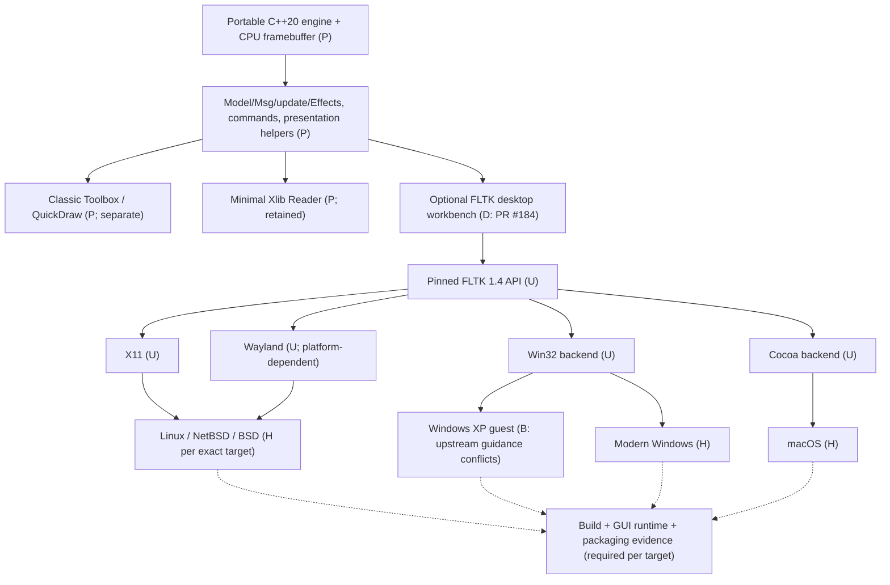

# FLTK portability dependencies — evidence and decision gates (2026-11-21)

**Status:** Exploratory, documentation-only research; not an accepted architecture decision, platform support statement, release requirement, or authorization to implement or run anything. **Related:** [#183](https://github.com/jackwillis/poodle-earth/issues/183), [draft prototype PR #184](https://github.com/jackwillis/poodle-earth/pull/184), [#114](https://github.com/jackwillis/poodle-earth/issues/114), [#176](https://github.com/jackwillis/poodle-earth/issues/176), [proposed ADR #193](https://github.com/jackwillis/poodle-earth/pull/193), [platform RICE archive](platform-rice-2026-11.md), [cross-platform research](cross-platform-frontends-and-distribution.md).

**Question:** Which future Poodle Earth targets could reuse an FLTK desktop frontend as their **preferred public Unix interface**, which targets would be better served by Xlib, and which inexpensive tests would improve those choices? The reusable FLTK implementation remains optional at build time until accepted on particular targets.

## Corrections established during review

1. **Product direction updated on November 21, 2026: one preferred Unix frontend per qualified target.** The November 18 direction to develop FLTK as an optional richer workbench alongside the minimal Xlib Reader was refined: **FLTK is now the intended default Unix experience wherever its build, runtime, UX and resource costs are acceptable**. Xlib remains the fallback/reference for Unix targets where FLTK is unavailable or impractical. Do **not** routinely ship competing FLTK and Xlib editions for the same platform. This is a *future target-selection policy*, not a claim of successful FLTK qualification, present binary distribution, or permission to remove Xlib. Maintenance savings from pausing Xlib are hypothetical until realized.
2. **Toolkits are not platform certifications.** A toolkit's documented platform backend, a pkgsrc binary, a cross-compiled Poodle Earth program, a GUI runtime smoke test, and a published supported artifact are different types of evidence.
3. **Windows XP is unresolved.** [FLTK 1.4 introduction](https://www.fltk.org/doc-1.4/intro.html) includes XP in historical support language, while [upstream Windows README](https://github.com/fltk/fltk/blob/master/README.Windows.txt) cautions that FLTK 1.4 and later may require Windows 10. These documents cannot establish a specific 1.4 build's XP import/API/CRT compatibility. Pin version/commit and test actual imports and an XP guest.
4. **No broad generic presenter is assumed.** [#114](https://github.com/jackwillis/poodle-earth/issues/114) has a null hypothesis: small separate native adaptations may remain cheaper. The accepted [ADR 0002](../adr/0002-rendering-shared-code-and-usability.md) and proposed [ADR #193](https://github.com/jackwillis/poodle-earth/pull/193) remain separate from this research.
5. **AI-assisted code creation is cheap relative to some owner-controlled costs**, but no project-specific multiplier is measured. Review, integration, physical validation, installation evidence and future maintenance must be separate budget dimensions.

## Evidence vocabulary and typed graph

| Code | Edge/evidence type | Permitted inference |
| --- | --- | --- |
| **P** | Present in current Poodle Earth default-branch source or recorded artifact | Implementation exists, subject to its own evidence limits |
| **D** | Implemented on an unmerged draft branch | Source exists; not validated or integrated solely by presence |
| **U** | Upstream toolkit or third-party package claim | Candidate route exists; does not prove Poodle Earth |
| **H** | Hypothesized cross-platform reuse | Portfolio option only, not a build/runtime assertion |
| **B** | Known blocker or conflicting evidence | Must clear with an exact falsifying test |
| **A** | Target-specific accepted runtime/packaging evidence | Applies only to recorded build, OS, ISA, configuration and acceptance steps |

These are **categorical evidence tags**, not scalar confidence probabilities. Each future measurement should preserve source URL, date, revision, target, environment, commands, observed output and caveats. A negative result is evidence.

The graph is a **dependency/reuse hypothesis graph**, not a causal DAG or a set of certified support claims. The parallel Xlib and FLTK branches represent available **engineering alternatives**, *not* a promise to distribute both to users on a target. Shared *semantics* do not imply identical window layouts, event loops, fonts, distribution artifacts or user experiences.

## Intended Unix product selection (owner direction, 2026-11-21)

For each separately qualified OS/architecture/runtime target, publish **one preferred Poodle Earth application** under the same public identity and command, rather than routinely asking users to choose a UI toolkit:

1. If the FLTK frontend passes target-specific build, runtime, interaction, performance, dependency and packaging acceptance, prefer FLTK as the distributed Unix frontend.
2. Otherwise, if Xlib passes that target's acceptance gates, distribute Xlib as a compatibility implementation. A constrained historical system may legitimately prefer Xlib even when FLTK technically compiles.
3. If neither implementation is qualified, do not claim a supported binary. Keep internal comparative builds where useful; **one preferred public distribution** does not prohibit development/test alternatives.

This **supersedes the November 18 assumption of permanently complementary public Unix applications**, not the existing Xlib baseline, tests or platform qualification evidence. Xlib development may eventually become maintenance-only or paused, but no source freeze, removal, test deletion or unsupported-platform declaration has been authorized. There is no mandatory pixel-level or widget-level frontend parity; share the geographic core and established semantic behavior (#114), and avoid a broad UI framework.

**Release interaction:** [#212](https://github.com/jackwillis/poodle-earth/issues/212) currently establishes **v0.1.3 as initial Unix distribution using the existing Xlib/X11 application** and **v0.1.4 as PoodleScripts**, not FLTK. Keep these release directions intact. Xlib may ship as a **transitional** Unix implementation while FLTK is still unqualified. The earlier tentative v0.1.4 FLTK suggestion in [#183](https://github.com/jackwillis/poodle-earth/issues/183) is superseded as a scheduling idea. Migrating a target to FLTK requires a distinct owner-approved release/product decision, evidence of usability and migration behavior (including configuration when persistence exists), and no promise of permanent parallel packages.

## What already exists in Poodle Earth

- On `main`: portable `globe_core`, common pixel format/helpers, platform-native OS 9 and `globe-x11` frontend, deterministic core tests, Xvfb-backed X11 tests where runnable. See [root CMakeLists.txt](../../CMakeLists.txt), [toolchain evidence](../toolchain.md), and [shared presentation inventory](../design/shared-presentation-architecture.md).
- In **draft PR #184** (not merged): optional `globe-fltk` source implementing navigation, resizing, cached frame presentation, look controls and an Information window. The reported Fedora 44/GCC 16.2.1 default build, 58 non-X11 tests and policy checks passed; **the FLTK-enabled build stopped at missing FLTK development files**. Ten X11 tests could not start Xvfb; Retro68 probe stopped at container setup. These results are **not FLTK compilation, GUI performance, native NetBSD acceptance or CI success**. [PR record](https://github.com/jackwillis/poodle-earth/pull/184).
- NetBSD/macppc: native headless core tests are recorded separately from any FLTK GUI. A [pkgsrc FLTK package index](https://ftp.jaist.ac.jp/pub/pkgsrc/current/pkgsrc/x11/fltk/index.html) lists a NetBSD 11.0 PowerPC binary; that does **not** verify the project's specific 11.1/macppc installation, library dependencies, X server, memory footprint or Poodle Earth binary.
- Upstream [FLTK](https://www.fltk.org/) documents X11/Wayland, Win32 and Cocoa. [FLTK 1.4 Wayland guidance](https://www.fltk.org/doc-1.4/wayland-devel.html) also warns against assuming X11-specific native handles work unchanged. Select/measure backend per environment.

## Target-specific reuse hypotheses

The table below is a technical qualification matrix, **not** a list of simultaneously shipped frontend variants. FLTK's intended default role applies only after qualification; otherwise the currently working Xlib application remains the practical Unix reference.

| Target / frontend | Existing evidence | Shared investment plausibly reused | Separate work and acceptance gate |
| --- | --- | --- | --- |
| Linux x86_64, FLTK/X11 | D: draft source; U: supported FLTK path | FLTK widgets, semantic actions, framebuffer presentation, test harness | **First gate:** pinned FLTK compile, Xvfb/local GUI smoke and paired Xlib measurements |
| Linux Wayland | U: upstream FLTK Wayland | Mostly same FLTK UI code | Verify framebuffer path, clipboard, input, scaling, backend-only dependencies |
| NetBSD 11.1/macppc | P: native *headless* engine; U: pkgsrc FLTK for related 11.0 PPC | Unix FLTK UI + embedded geography | Actual 11.1 package/compiler/ABI, GUI and memory acceptance; G4 access owner-only |
| FreeBSD/OpenBSD desktop | U: Unix X11 and toolkit ecosystem | Unix FLTK workbench | Per-OS native build, libc/dependency, X server, packaged install tests |
| Windows 10/11 | U: Win32 backend | FLTK UI + portable engine | Windows compiler, resource/API/CRT and real Windows UI acceptance |
| Windows XP/i686 | B: upstream FLTK guidance conflicts | Possible FLTK UI reuse if pinned build works | 32-bit compiler/CRT/import audit + authentic XP guest; fallback Win32/GDI independent |
| Windows 98 SE/i586 | H only; #176 owns experiment | Geographic core and command semantics first | Historical compiler/CRT/API, GDI control vs pinned FLTK 1.3, authentic Win98 guest; **not an FLTK 1.4 assumption** |
| Modern macOS | U: FLTK Cocoa backend | FLTK widgets and core | macOS toolchain/SDK, universal binary or individual ISAs, app packaging, native tests |
| Mac OS X Tiger PowerPC | H; SDK/provenance unresolved | Geographic core, maybe separate GUI | Native GUI SDK/legal provenance, ABI/CPU/runtime proof; modern FLTK Cocoa is not assumed compatible |
| Classic Mac OS PPC | P: separate production Toolbox path | Geographic engine and semantic behaviors only | Retain native QuickDraw/Toolbox; no FLTK dependency |

## Portfolio model interface: benefits, costs, uncertainty

For each candidate platform `p`, do **not** assign a fixed platform RICE bonus when `fltk` is selected. Record:

- `prerequisites`: mandatory dependencies (AND), alternative paths (OR), and **version-sensitive** compatibility.
- `shared_capabilities`: confirmed or hypothesized reusable application code; explicit `evidence_type` on each graph edge.
- `owner_attention`, `agent_execution`, `integration`, `automated_validation`, `manual_hardware_validation`, `ongoing_maintenance`: distinct cost measures. Keep distributions/unknowns instead of fabricated precision.
- `outcome`: target-specific verified build, launch, navigation, installation and release status. Do not sum audience estimates across overlapping platform versions or distribution packages.
- `counterfactual`: expected incremental work *with FLTK already integrated* versus best alternative path. A source-sharing percentage alone is not evidence of time saved.

The marginal benefit is conditional: `Delta V(p | completed investments)`; the marginal cost must include regression and maintenance obligations. Measure owner attention separately from elapsed agent time. The old [71-scenario RICE CSV](platform-rice-scenario-inputs-2026-11.csv) is a hypothetical input snapshot, not demand data or an AI-adjusted cost model.

## Smallest discriminating experiments (proposals, not permissions)

| Order | Experiment | Falsifiable observation / stop condition | Decision improved |
| --- | --- | --- | --- |
| **1** | #183 / PR #184: pinned Linux FLTK 1.4 build and paired Xlib control | Same viewport, atlas and scripted input; compare core-state/pixel behavior, RSS/peak, executable/dependency size, startup, frame conversion/copy and interaction. Stop/report negative if FLTK build or GUI smoke fails. | Is FLTK viable as optional workbench? |
| **2** | Assess cross-backend API boundary in draft code, read-only | Count platform-specific calls/headers; verify event, font and framebuffer assumptions. No backend promise from this review. | How much work can Windows/Cocoa truly reuse? |
| **3** | Compare automation routes on host/virtual targets | Explicit pass/fail artifacts and failure detection; distinguish Xvfb, Wine and authentic OS guest. | Owner-attention and maintenance costs |
| **4** | #176: pinned FLTK vs raw Win32 control and import audit | Windows XP/98 separate cases, authentic guest required for each. A failed FLTK probe need not block Win32. | Whether Windows reuse is economical |
| **5** | NetBSD/macppc GUI, only after owner authorization | Compare local X server vs SSH-forwarded display, partition/RSS and input/paint timings; no assumed performance from pkgsrc listing. | NetBSD package eligibility |

**Next technical gate now:** unblock the existing Linux #184 FLTK-enabled build with available development packages and usable Xvfb/local X11, then perform paired comparison. This determines whether FLTK can *eventually* become the preferred Unix frontend on Linux; it does **not** reopen v0.1.3's approved Xlib packaging scope or replace the v0.1.4 PoodleScripts theme. Do not open a parallel implementation ticket or modify the source via this research. 

## Limits, provenance and ownership

This research examined the main-branch documents, #183 with its November 18 owner-direction comment, #114, #176, #193 and draft PR #184, plus official FLTK and pkgsrc documentation (web verification on November 21, 2026). Source-backed claims above are narrower than the broader portability hypothesis. It does not independently reproduce the draft's local tests, benchmark a FLTK build, inspect the full draft source line-by-line, or measure owner-time. The model remains research only.

**No implementation, package release, accepted-ADR modification, new data source/license, G4 access, issue ownership/status change, milestone adjustment or support promise follows from this document.** This amendment records the owner-stated product preference without changing the approved #212 release sequence; research updates belong with #183/#114/#176, with existing #213 preserved as historical archive rather than reopened.
